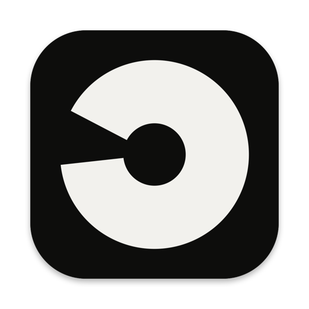
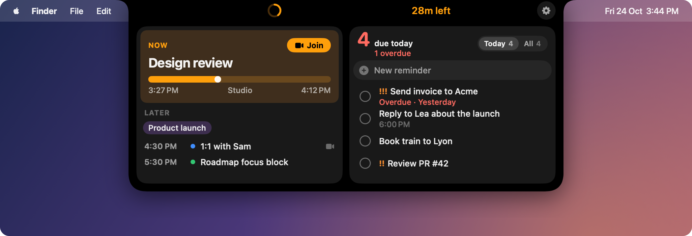
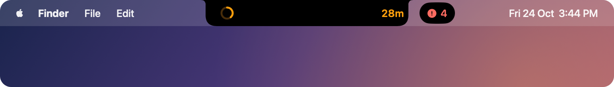
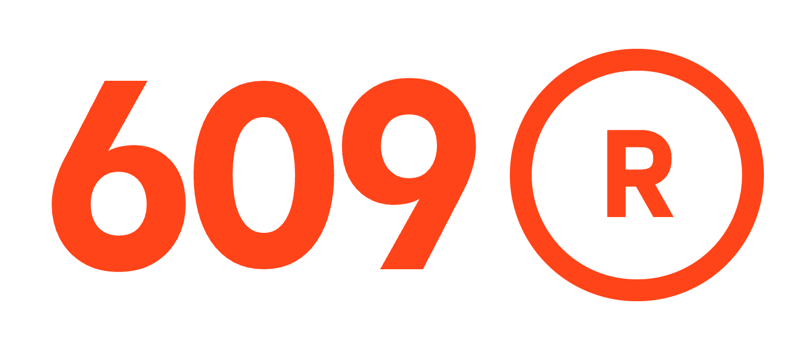

  

<h1 align="center">opa.notch</h1>

Your day and your reminders, living in the MacBook notch.

  <a href="../../releases/latest/download/opa.notch.dmg"><b>Download for macOS</b></a>

  

- **Closed:** a countdown to your current or next meeting, and how many reminders are due today.
- **Open** (hover or <kbd>⌃⌥N</kbd>): today's meetings with one-click **Join**, and your reminders to check off, reschedule or prioritise.
- **Quick add** (<kbd>⌃⌥R</kbd>): type `Send invoice friday 10am` and it lands in Apple Reminders, due Friday at 10:00.

  

Everything syncs through Apple Calendar and Reminders. opa.notch stores no data of its own.

## Install

1. Download [opa.notch.dmg](../../releases/latest/download/opa.notch.dmg) and drag the app into Applications (macOS 14+).
2. On first launch, approve it in **System Settings → Privacy & Security → Open Anyway**. It isn't notarized yet.
3. Hover over the notch and click **Allow Access** for Calendar and Reminders.

## Build

Open `OpaNotch.xcodeproj` in Xcode 26 and run the **OpaNotch** scheme. To package a release, run `scripts/build-release.sh`. It writes `dist/opa.notch.dmg` to attach to a GitHub release.

## License

GPL-3.0. See `LICENSE` and `THIRD_PARTY_LICENSES`.

---

  DESIGNED, CRAFTED AND ENGINEERED BY

  

